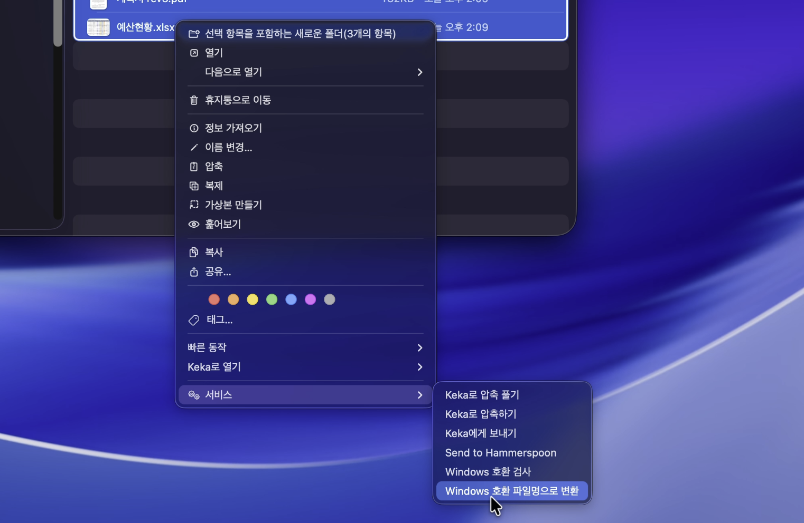

<div align="center">

# `quickJaso`

**macOS 파일명 Unicode NFC 검사 및 변환 앱**

Finder 우클릭 한 번으로 파일과 폴더 이름을 Windows에서 자소가 분리되지 않는 NFC 형식으로 검사하고 변환합니다.

[](https://github.com/hungryZoo/quickJaso/releases/latest)
[](LICENSE)
[](https://github.com/hungryZoo/quickJaso/actions/workflows/ci.yml)
[](Package.swift)

```bash
brew install hungryZoo/tap/quickjaso
xattr -dr com.apple.quarantine "/Applications/quickJaso.app"
open -a "quickJaso"
```

[](#6-플랫폼-지원과-제한사항)
[-000000)](#6-플랫폼-지원과-제한사항)



</div>

---

Finder에서 파일이나 폴더를 선택하고 우클릭 → **서비스** → `Windows 호환 검사`를 고르면, 하위 항목까지 재귀 검사한 결과가 화면 우상단의 작은 패널에 표시됩니다.
`Windows 호환 파일명으로 변환`을 고르면 NFC가 아닌 이름만 골라 NFC로 바꾸고, 바뀐 항목 수와 건너뛴 항목 수를 같은 패널에 표시합니다.
파일 **내용**은 바꾸지 않고 파일과 폴더의 **이름**만 바꿉니다.
이름 충돌, 권한 오류, 클라우드 미다운로드 항목은 변경하지 않고 건너뜁니다(fail-safe).

<div align="center">

https://github.com/user-attachments/assets/9a5e5b64-c94f-42ec-b0c9-a6d2145efc14

</div>

---

## 목차

1. [개요](#1-개요)
   - [해결 대상 문제](#해결-대상-문제)
   - [NFC와 NFD의 차이](#nfc와-nfd의-차이)
   - [Windows 전달 시 문제 원인](#windows-전달-시-문제-원인)
   - [이름만 바꾸는 원칙](#이름만-바꾸는-원칙)
2. [설치](#2-설치)
   - [Homebrew (권장)](#homebrew-권장)
   - [DMG 직접 설치](#dmg-직접-설치)
   - [업데이트](#업데이트)
   - [제거](#제거)
   - [남은 서비스 등록 정리](#남은-서비스-등록-정리)
3. [빠른 시작](#3-빠른-시작)
4. [사용법](#4-사용법)
   - [Windows 호환성 검사](#windows-호환성-검사)
   - [Windows 호환 파일명으로 변환](#windows-호환-파일명으로-변환)
   - [앱 창과 단축키](#앱-창과-단축키)
   - [결과 상태와 색상, 아이콘](#결과-상태와-색상-아이콘)
   - [이름 충돌 처리](#이름-충돌-처리)
   - [변환 전 확인 정책](#변환-전-확인-정책)
5. [설정](#5-설정)
   - [설정 항목](#설정-항목)
   - [Finder 서비스 활성화](#finder-서비스-활성화)
   - [권한, Sandbox, security-scoped URL](#권한-sandbox-security-scoped-url)
   - [전체 디스크 접근 권한](#전체-디스크-접근-권한)
6. [플랫폼 지원과 제한사항](#6-플랫폼-지원과-제한사항)
   - [지원 환경](#지원-환경)
   - [알려진 제한사항](#알려진-제한사항)
   - [주의사항](#주의사항)
7. [개발](#7-개발)
   - [저장소 구조](#저장소-구조)
   - [빌드](#빌드)
   - [테스트](#테스트)
   - [수동 테스트 체크리스트](#수동-테스트-체크리스트)
8. [로드맵](#8-로드맵)
9. [라이선스](#9-라이선스)

---

## 1. 개요

### 해결 대상 문제

macOS(특히 HFS+ 시절부터 이어진 관행)에서는 한글 파일명이 **NFD**(자소 분리형)로 저장되는 경우가 많습니다.
macOS 안에서는 정상적으로 보이지만, 이 파일을 Windows, NAS, 압축 파일, Git, 일부 동기화 서비스로 옮기면
`한글.txt`가 `ㅎㅏㄴㄱㅡㄹ.txt`처럼 자소가 분리되어 보이거나, 같은 이름의 파일이 두 개로 인식됩니다.

quickJaso는 선택한 파일과 폴더(하위 포함)의 이름이 NFC인지 검사하고, NFC가 아닌 이름만 골라 NFC로 바꿉니다.

### NFC와 NFD의 차이

| 형식 | 설명 | 예 (`한`) |
|---|---|---|
| **NFC** (Normalization Form C) | 조합 가능한 문자를 하나의 완성형 코드로 합친 형태 | `U+D55C` (1 코드포인트) |
| **NFD** (Normalization Form D) | 문자를 기본 자소로 분해한 형태 | `U+1112 U+1161 U+11AB` (3 코드포인트) |

두 형식은 화면에서는 똑같이 `한`으로 보이지만 바이트가 다릅니다.
이 앱의 목표 형식은 **NFC 하나**이며, 호환성 분해까지 수행하는 NFKC와 NFKD는 사용하지 않습니다(예: `①`이 `1`로 바뀌지 않음).

검사 범위는 한글에 한정되지 않고 결합 악센트(`é` = `e` + `◌́`) 등 **모든 Unicode 문자열**입니다.

### Windows 전달 시 문제 원인

- Windows(NTFS)는 파일명을 정규화하지 않고 **바이트 그대로** 저장하고 비교합니다. NFD 이름은 자소 분리 상태 그대로 보입니다.
- 압축 프로그램, SMB와 NAS, 서버, 버전 관리 도구도 대부분 정규화를 하지 않아 NFC `한글.txt`와 NFD `한글.txt`를 **서로 다른 파일**로 취급합니다.
- macOS APFS는 정규화 **비민감**(insensitive)이자 **보존**(preserving) 파일 시스템이라 어느 형식으로 저장돼 있어도 같은 파일로 찾습니다. 그래서 macOS 안에서는 문제가 드러나지 않습니다.

### 이름만 바꾸는 원칙

| 대상 | 동작 |
|---|---|
| 파일 내용, 수정 시각, 확장 속성 | 변경 없음 |
| 이름 변경 범위 | 같은 부모 폴더 안에서 이름만 변경 |
| 확장자 | 분리하거나 바꾸지 않음. 파일명 전체를 하나의 문자열로 NFC 변환 |
| 이미 NFC인 항목 | 변경 없음 |
| 충돌, 권한 오류, 클라우드 미다운로드 등 불확실한 항목 | 건너뜀(fail-safe) |

변환 흐름은 `검사 → 계획(충돌 판정) → 깊은 경로부터 rename → 결과 집계` 4단계 파이프라인입니다.
APFS에서는 Foundation `moveItem(NFD → NFC)`이 아무 변화 없이 성공을 반환하므로, rename은 다음 2단계로 수행합니다.

1. `FileManager.moveItem`으로 같은 폴더의 임시 ASCII 이름(`.quickjaso-tmp-<UUID>`)으로 이동
2. BSD `renamex_np(RENAME_EXCL)`(덮어쓰기 금지)로 NFC 이름 바이트를 그대로 전달해 최종 이름으로 이동

이후 디렉터리 목록을 다시 읽어 NFC 바이트가 기록되고 원래 NFD 바이트가 사라졌는지 검증합니다. 중간 단계가 실패하면 원래 이름으로 되돌리고, 검증에 실패하면 성공으로 보고하지 않습니다.

<p align="right"><a href="#목차">↑ 목차로</a></p>

---

## 2. 설치

설치 위치는 `/Applications/quickJaso.app`입니다. 지원 환경은 [6. 플랫폼 지원과 제한사항](#6-플랫폼-지원과-제한사항)을 참고하세요.

### Homebrew (권장)

```bash
brew install hungryZoo/tap/quickjaso
xattr -dr com.apple.quarantine "/Applications/quickJaso.app"
open -a "quickJaso"
```

앱은 ad-hoc 서명이며 Apple 공증을 받지 않았습니다. 그래서 격리 속성이 남아 있으면 macOS가 첫 실행을 차단하고, `xattr` 줄이 이 속성을 지웁니다.
전체 이름(`hungryZoo/tap/quickjaso`)으로 설치하면 tap 추가와 cask 선택은 Homebrew가 처리합니다. Homebrew 7에는 격리 속성을 건너뛰는 설치 옵션이 없습니다.
cask 정의는 [hungryZoo/homebrew-tap](https://github.com/hungryZoo/homebrew-tap/blob/main/Casks/quickjaso.rb)에 있습니다.

`xattr` 대신 **시스템 설정 → 개인정보 보호 및 보안 → 그래도 열기**로 직접 승인해도 됩니다.

### DMG 직접 설치

1. [Releases](https://github.com/hungryZoo/quickJaso/releases/latest)에서 `quickJaso-<버전>.dmg`를 내려받습니다.
2. DMG를 열고 `quickJaso.app`을 `Applications` 폴더 아이콘으로 드래그합니다.
3. 브라우저로 내려받은 파일에는 격리 속성이 붙어 있어 첫 실행이 차단됩니다. 다음 중 하나를 수행합니다.
   - 터미널에서 격리 속성 제거:

     ```bash
     xattr -dr com.apple.quarantine "/Applications/quickJaso.app"
     ```

   - 앱을 한 번 실행해 경고를 닫은 뒤 **시스템 설정 → 개인정보 보호 및 보안 → 그래도 열기** (macOS 13-14는 Finder에서 앱 **우클릭 → 열기**)
4. 앱을 실행하면 Finder 서비스가 등록되고, 첫 실행 시 전체 디스크 접근 권한 안내 창이 나타납니다.

체크섬 검증은 같은 릴리스의 `.sha256` 파일을 함께 내려받은 폴더에서 실행합니다.

```bash
shasum -a 256 -c quickJaso-<버전>.dmg.sha256
```

### 업데이트

quickJaso를 종료한 뒤 실행합니다. `xattr` 단계는 공증 전까지 업데이트할 때마다 필요합니다.

```bash
brew update
brew upgrade hungryZoo/tap/quickjaso
xattr -dr com.apple.quarantine "/Applications/quickJaso.app"
open -a "quickJaso"
```

Homebrew 7은 신뢰하지 않은 서드파티 tap을 이름 없는 `brew upgrade`에서 건너뛰므로 전체 이름으로 실행합니다.
이름 없는 `brew upgrade`에도 포함하려면 한 번만 `brew trust --cask hungryZoo/tap/quickjaso`를 실행합니다.

설치나 업데이트 직후 Finder 우클릭 메뉴에 서비스가 보이지 않으면 `/System/Library/CoreServices/pbs -update`를 실행하거나 로그아웃 후 다시 로그인합니다.

### 제거

```bash
brew uninstall hungryZoo/tap/quickjaso
brew untap hungryZoo/tap
/System/Library/CoreServices/pbs -flush
```

설정 파일(`~/Library/Preferences/com.heonzoo.quickJaso.plist`)까지 지우려면 첫 줄 대신 `brew uninstall --zap hungryZoo/tap/quickjaso`를 실행합니다.
`brew untap`은 같은 tap의 다른 앱을 쓰지 않을 때만 실행합니다.

### 남은 서비스 등록 정리

제거 후에도 Finder 우클릭 메뉴에 `Windows 호환 검사`가 남아 있으면 디스크에 **다른 quickJaso.app 사본**(휴지통, 다운로드 폴더, 열어 둔 DMG, 소스 빌드 폴더의 `build/quickJaso.app` 등)이 있는 상태입니다.
macOS는 디스크에 있는 앱을 다시 등록하므로 등록 해제만으로는 부족하고 **사본 자체를 지워야** 합니다.
휴지통 비우기, DMG 추출, 소스 빌드 사본 삭제(`rm -rf build`) 후 다음을 실행합니다.

```bash
LSR=/System/Library/Frameworks/CoreServices.framework/Frameworks/LaunchServices.framework/Support/lsregister
$LSR -dump | grep -E '^\s*path:\s+.*quickJaso\.app'   # 남아 있는 사본 확인
$LSR -u "/path/to/남은/quickJaso.app"                      # 각 사본 등록 해제
/System/Library/CoreServices/pbs -flush
```

저장소의 `scripts/unregister-services.sh`가 같은 작업을 자동으로 수행합니다.

| 옵션 | 동작 |
|---|---|
| (없음) | `/Applications`와 `~/Applications` 사본은 유지하고 나머지 사본만 등록 해제, `pbs -flush`와 `pbs -update` 실행 |
| `--all` | `/Applications` 사본까지 포함해 전부 등록 해제 |
| `--dry-run` | 대상만 출력하고 실제 명령은 실행하지 않음 |

그래도 남으면 로그아웃 후 다시 로그인합니다.

<p align="right"><a href="#목차">↑ 목차로</a></p>

---

## 3. 빠른 시작

1. [설치](#2-설치) 블록의 세 줄을 실행합니다. 첫 실행 시 `권한 설정 안내` 창이 나타납니다.
2. 안내에 따라 전체 디스크 접근 권한을 켜고 quickJaso를 다시 실행합니다(선택 사항, [전체 디스크 접근 권한](#전체-디스크-접근-권한) 참고).
3. Finder에서 폴더를 선택하고 우클릭 → **서비스** → `Windows 호환 검사`를 고릅니다.
4. 결과 패널에서 **NFC로 변환…** 을 누르면 같은 대상을 변환합니다.

테스트용 NFD 파일은 다음 명령으로 만들 수 있습니다.

```bash
mkdir -p ~/Desktop/nfc-test && cd ~/Desktop/nfc-test && printf 'hello' > "$(printf '\xe1\x84\x92\xe1\x85\xa1\xe1\x86\xab\xe1\x84\x80\xe1\x85\xb3\xe1\x86\xaf.txt')"
```

<p align="right"><a href="#목차">↑ 목차로</a></p>

---

## 4. 사용법

### Windows 호환성 검사

1. Finder에서 파일 또는 폴더를 하나 이상 선택합니다.
2. 우클릭 → **서비스** → **Windows 호환 검사**를 선택합니다. 서비스 항목이 적으면 컨텍스트 메뉴 하단에 바로 표시됩니다.
3. 화면 우상단에 결과 패널이 나타납니다. 폴더는 하위 항목까지 재귀 검사합니다.

```
Windows 호환성 검사 완료
✓ Windows 호환 (NFC): 18개
! NFC 변환 필요: 3개
✕ 변환 불가: 1개
? 확인 불가: 0개
[상세 보기] [NFC로 변환…] [닫기]
```

| 버튼 | 동작 |
|---|---|
| 상세 보기 | 항목별 결과 테이블(상세 결과 창) 표시 |
| NFC로 변환… | 같은 대상에 대한 변환 흐름 시작 |
| 닫기 | 패널 닫기 |

- 검사는 파일 시스템을 변경하지 않습니다.
- 검사 결과 패널은 4초 후 자동으로 닫힙니다(마우스를 올리면 유지). 패널이 닫히면 앱도 종료됩니다([앱 창과 단축키](#앱-창과-단축키) 참고).

### Windows 호환 파일명으로 변환

1. Finder에서 파일 또는 폴더를 선택합니다.
2. 우클릭 → **서비스** → **Windows 호환 파일명으로 변환**을 선택합니다.
3. 최초 1회 또는 위험 조건일 때 확인 창에서 **변환** 또는 **계속 변환**을 누릅니다.
4. 결과 패널이 표시됩니다.

검사를 먼저 실행할 필요는 없습니다. 변환은 내부에서 검사부터 다시 수행합니다.

```
일부 항목만 변환했습니다
✓ 변환됨: 12개
✓ 이미 호환: 18개
✕ 이름 충돌: 2개
? 확인 불가: 1개
충돌하거나 접근할 수 없는 항목은 변경하지 않았습니다.
[문제 항목 보기] [변경 내역 보기] [닫기]
```

변환 결과 패널은 충돌, 오류, 확인 불가 항목이 있거나 10개 이상 변경됐을 때 사용자가 닫을 때까지 유지되고, 그 외에는 4초 후 닫힙니다.

### 앱 창과 단축키

quickJaso는 메뉴바 아이콘 없이, 필요할 때만 실행되고 일이 끝나면 종료됩니다.

| 실행 경로 | Dock 아이콘과 앱 메뉴 | 종료 시점 |
|---|---|---|
| Finder 서비스, URL | 표시 안 함. 결과 패널만 표시 | 작업이 끝나고 결과 패널, 확인 창, 상세 결과 창, 권한 안내 창이 모두 닫혔을 때 |
| 직접 실행 (Finder 더블클릭, Launchpad, Spotlight) | 메인 창이 열려 있는 동안 표시 | 마지막 창을 닫았을 때 |

- 메인 창에 파일을 드래그 앤 드롭해 같은 검사를 실행할 수 있습니다.
- 앱이 종료되면 마지막 결과도 사라집니다. 상세 결과가 필요하면 결과 패널이 떠 있는 동안 **상세 보기**를 누릅니다.
- 메인 창이 열려 있을 때 Finder 서비스를 실행하면 메인 창이 숨겨지고 서비스 실행과 같은 방식으로 동작합니다.

아래 단축키와 메뉴는 메인 창이 열려 있어 앱 메뉴가 표시될 때 사용합니다.

| 단축키 | 메뉴 | 동작 |
|---|---|---|
| `⌘O` | File → 열어서 검사… | 열기 패널에서 고른 항목 검사 |
| `⇧⌘O` | File → 열어서 변환… | 열기 패널에서 고른 항목 변환 |
| `⌘D` | File → 상세 결과 보기 | 마지막 결과의 상세 결과 창 표시 |
| `⌘,` | quickJaso → Settings… | 설정 창 표시 |
| (없음) | Help → 전체 디스크 접근 권한 설정… | 권한 설정 안내 창 표시 |

상세 결과 창은 필터, **Finder에서 보기**, **변경 내역 복사**, **CSV 내보내기**를 제공합니다.

### 결과 상태와 색상, 아이콘

| 상태 | 색 | 아이콘 | 의미 |
|---|---|---|---|
| Windows 호환 (NFC) | 초록 | `checkmark.circle.fill` | 이미 NFC. 변경 없음 |
| Windows 호환으로 변환됨 | 초록 | `checkmark.circle.fill` | 이번 작업에서 NFC로 변경됨 |
| NFC 변환 필요 | 주황 | `exclamationmark.triangle.fill` | NFC가 아님. (검사 모드) 충돌 없이 변환 가능할 수 있음 |
| 변환 불가 — 이름 충돌 | 빨강 | `xmark.octagon.fill` | NFC로 바꾸면 같은 폴더의 다른 항목과 이름이 겹침 |
| 변환 불가 — 접근 오류 | 빨강 | `xmark.octagon.fill` | 권한 부족, 읽기 전용 볼륨, 파일 시스템 오류 등 |
| 확인 불가 | 회색 | `questionmark.circle` | iCloud, Dropbox 등에서 아직 내려받지 않았거나 상태를 확인할 수 없음 |

- NFC가 아니라는 이유만으로 빨간색을 쓰지 않습니다. 빨강은 사용자가 직접 조치해야 하는 충돌, 권한, 오류에만 사용합니다.
- 상태는 항상 **색상 + 아이콘 + 텍스트**로 함께 표시하며, 모든 아이콘에 VoiceOver 레이블이 있습니다.

### 이름 충돌 처리

다음 경우를 충돌로 판정하며, 실제 변경 **전에** 계획 단계에서 검사합니다.

1. 같은 부모 폴더에 NFC 변환 후 이름과 같은 **다른** 항목이 이미 있음
2. 서로 다른 원본 이름들이 NFC 변환 뒤 **같은 이름으로 수렴**함
3. 파일 시스템이 NFC와 NFD를 구별하지 않아 목적지 존재 여부가 애매하고, 같은 항목인지 안전하게 판단할 수 없음
4. 변환 대상이 아닌 기존 항목과 이름이 겹침

충돌 항목은 덮어쓰기, `- 2` 같은 접미사 부여, 병합, 삭제 없이 `변환 불가 — 이름 충돌`로만 보고하고, 나머지 안전한 항목은 계속 변환합니다.
상세 결과 창의 **Finder에서 보기**로 충돌 항목을 열어 직접 정리한 뒤 다시 실행합니다.

> **Finder 전달 경로 주의점**: Finder는 파일 URL의 이름을 NFD로 분해해 전달하는 경우가 있어, 이미 NFC로 바뀐 파일도 URL만 보면 NFD처럼 보입니다.
> quickJaso는 URL 문자열이 아니라 **디스크의 실제 디렉터리 항목 이름**(`.nameKey`와 file resource identifier 대조)을 기준으로 판정합니다. 그래서 변환을 마친 항목을 다시 검사하거나 변환하면 `이미 Windows 호환 파일명입니다`로 표시됩니다.

### 변환 전 확인 정책

**최초 1회 확인**: 처음 변환할 때 한 번만 확인 창이 나타납니다. **앞으로 묻지 않기**를 선택하면 이후에는 바로 변환하고 결과만 표시합니다(설정에서 되돌릴 수 있음).

**위험 조건 추가 확인**: "묻지 않기"를 켰더라도 아래 중 하나라도 해당하면 변환 직전에 다시 확인합니다.

| 조건 | 기준 |
|---|---|
| 검사 대상 수 | 100개 이상 |
| 실제 이름 변경 대상 수 | 50개 이상 |
| 이름 충돌 | 1개 이상 |
| 동기화 경로 | iCloud Drive, Dropbox, OneDrive, Google Drive 등 |
| 볼륨 종류 | 외장 디스크 또는 네트워크 볼륨 |
| Git 저장소 | 상위 경로에 `.git`이 있음 |
| package 내부 재귀 | 설정에서 켜져 있음 |

확인 창에는 바뀔 항목 수, 유지될 항목 수, 건너뛸 항목 수, 위험 요약과 **취소**, **계속 변환** 버튼이 표시됩니다.

<p align="right"><a href="#목차">↑ 목차로</a></p>

---

## 5. 설정

### 설정 항목

설정 창(`⌘,`)의 항목과 기본값입니다. 값은 `~/Library/Preferences/com.heonzoo.quickJaso.plist`에 저장됩니다.

| 항목 | 기본값 | 설명 |
|---|---|---|
| 변환 전 확인 창 건너뛰기 | 꺼짐 | 최초 확인 창 생략. 위험 조건 확인은 계속 표시 |
| 심볼릭 링크 이름도 변환 | 꺼짐 | 링크 자체의 이름만 변환. 링크 대상은 처리하지 않음 |
| package(.app 등) 내부까지 변환 | 꺼짐 | 켜면 항상 위험 확인 창 표시 |
| 숨김 파일 포함 | 켜짐 | 숨김 파일과 폴더도 검사 및 변환 |

### Finder 서비스 활성화

quickJaso는 macOS **서비스(NSServices)** 로 Finder에 통합되며 별도 Automator 워크플로가 필요 없습니다.

1. `quickJaso.app`을 **`/Applications`** 또는 `~/Applications`에 둡니다.
2. 앱을 한 번 실행합니다. Launch Services가 서비스를 등록합니다.
3. 서비스가 보이지 않으면 로그아웃 후 다시 로그인하거나, 다음 명령으로 등록을 갱신합니다.

   ```bash
   /System/Library/Frameworks/CoreServices.framework/Frameworks/LaunchServices.framework/Support/lsregister -f /Applications/quickJaso.app
   ```

4. **시스템 설정 → 키보드 → 키보드 단축키… → 서비스 → 파일 및 폴더**에서 `Windows 호환 검사`, `Windows 호환 파일명으로 변환`의 체크 상태를 확인합니다. 단축키도 여기서 지정합니다.
5. Finder 우클릭 메뉴의 **서비스** 하위 메뉴(또는 메뉴 하단)에 두 항목이 나타납니다. Finder는 서비스 항목을 제목 문자열 순으로 정렬하므로 `Windows 호환 검사`가 위, `Windows 호환 파일명으로 변환`이 아래입니다.

### 권한, Sandbox, security-scoped URL

- 기본 빌드는 **App Sandbox를 켜지 않습니다.** 서비스로 전달된 파일 URL에 대한 sandbox 접근 보장이 macOS 버전에 따라 불확실하기 때문입니다. 대신 Finder가 서비스 pasteboard(`public.file-url`)로 넘겨준 URL만 사용하며, 임의 경로 문자열이나 shell 명령은 사용하지 않습니다.
- 코드 전반에 `startAccessingSecurityScopedResource()`와 `stopAccessingSecurityScopedResource()` 패턴을 적용했습니다. `./scripts/build-app.sh --sandbox`로 `Resources/quickJaso.entitlements`를 적용해 sandbox를 켜도 드래그 앤 드롭과 열기 패널 경로는 동작합니다.
- 전체 디스크 접근 권한이 없으면 외장 디스크, 네트워크 볼륨, `~/Desktop`과 `~/Documents` 등 보호 폴더에 접근할 때 macOS가 **폴더 접근 권한** 대화상자를 띄울 수 있습니다. 거부한 항목은 `변환 불가 — 접근 오류`로 보고됩니다.
- 읽기 전용 볼륨, 잠긴 파일, 권한 없는 폴더는 변경하지 않고 오류로 보고합니다.
- Git 저장소 감지는 `.git` 상위 탐색만 수행하며 Git 명령을 실행하거나 Git 상태를 바꾸지 않습니다.

### 전체 디스크 접근 권한

이 앱은 macOS 로컬 알림(Notification)을 사용하지 않습니다. 모든 결과는 앱의 결과 패널과 상세 창으로 표시됩니다.

앱을 **처음 실행하면** `권한 설정 안내` 창이 나타나 macOS **전체 디스크 접근 권한**(Full Disk Access) 설정을 안내합니다.

- 데스크탑, 문서, 다운로드, 외장 디스크, iCloud Drive 등 보호된 위치의 항목을 매번 묻지 않고 처리하려면 이 권한이 필요합니다.
- 권한이 없어도 앱은 동작하며, 접근할 수 없는 항목은 `변환 불가 — 접근 오류`로 표시됩니다.
- 앱은 권한을 스스로 바꾸지 않습니다. `시스템 설정 열기` 버튼은 **시스템 설정 → 개인정보 보호 및 보안 → 전체 디스크 접근 권한** 화면만 엽니다. 목록에서 quickJaso를 켜는 것은 사용자가 직접 하며, 목록에 없으면 `+` 버튼으로 `/Applications/quickJaso.app`을 추가합니다.
- 권한 변경은 quickJaso를 종료했다가 다시 실행해야 적용됩니다.
- `앞으로 표시하지 않기`를 선택하면 안내 창이 자동으로 뜨지 않습니다. **도움말 → 전체 디스크 접근 권한 설정…** 메뉴나 설정 창에서 다시 열 수 있습니다.
- 안내 창의 `현재 상태`는 보호된 폴더 목록을 읽어 보는 방식의 추정값이라 실제와 다를 수 있습니다.

<p align="right"><a href="#목차">↑ 목차로</a></p>

---

## 6. 플랫폼 지원과 제한사항

### 지원 환경

| 항목 | 지원 범위 |
|---|---|
| macOS | 13 Ventura 이상 (`LSMinimumSystemVersion` 13.0) |
| CPU | Apple Silicon (arm64). 배포 바이너리는 universal이 아니므로 Intel Mac은 미지원 |
| Homebrew | 7 이상 기준으로 안내 작성 |
| UI 언어 | 한국어 |

### 알려진 제한사항

- Finder "빠른 동작" 섹션은 Automator 워크플로와 Action Extension 전용이라, 앱 서비스는 **서비스** 섹션에 표시됩니다(Action Extension 미구현).
- Finder 배지(Finder Sync Extension)는 제공하지 않습니다.
- 되돌리기(undo)는 미제공입니다. 작업 기록 모델(`OperationRecord`)과 UI 진입점만 있습니다.
- 심볼릭 링크 자체의 이름 변경은 기본 꺼짐이며 설정에서 켤 수 있습니다. 링크 대상은 처리하지 않습니다.
- package(.app 등) 내부는 기본적으로 처리하지 않습니다.
- 정규화 비민감 파일 시스템에서 동일 항목 여부를 판단할 수 없으면 fail-safe로 충돌 처리합니다.
- **서명과 공증 없음**: Apple Developer Program 인증서가 없어 ad-hoc 서명만 되어 있습니다. 그래서 인터넷에서 내려받은 뒤 첫 실행 시 [설치](#2-설치)의 `xattr` 단계가 필요합니다. Developer ID 서명과 notarization을 적용하면 이 단계가 사라집니다.

### 주의사항

- **중요한 파일은 변환 전 백업**을 권장합니다.
- iCloud, Dropbox, OneDrive 등 **동기화가 진행 중인 폴더**에서는 동기화 클라이언트가 이름 변경을 별도 파일로 인식할 수 있습니다.
- **Git 저장소**에서는 파일명 변경이 rename(또는 delete + add)으로 인식됩니다. 변환 후 `git status`를 확인합니다.
- **외장 디스크, NAS, 네트워크 파일 시스템**은 정규화 처리 방식이 달라 동작 차이가 있을 수 있습니다.
- **이름 충돌 항목은 자동 변경되지 않습니다.** 직접 정리한 뒤 다시 실행합니다.

<p align="right"><a href="#목차">↑ 목차로</a></p>

---

## 7. 개발

### 저장소 구조

```
quickJaso/
├── Package.swift
├── Sources/
│   ├── QuickJasoCore/       # Foundation 전용 핵심 로직 (Models, Services)
│   └── QuickJaso/           # macOS 앱 (App, ViewModels, Views, Panels, QuickAction, Services)
├── Tests/QuickJasoCoreTests/
├── Resources/               # Info.plist(NSServices), entitlements, AppIcon.icns
├── .github/
│   ├── workflows/ci.yml     # GitHub Actions: build, test, app bundle
│   └── release-notes/       # 버전별 릴리스 노트 (v<version>.md)
├── scripts/
│   ├── build-app.sh         # build/quickJaso.app 조립과 ad-hoc 서명 (--sandbox 옵션)
│   ├── build-dmg.sh         # dist/ DMG, sha256, Homebrew cask 파일 생성
│   ├── unregister-services.sh  # 남은 quickJaso.app 사본의 서비스 등록 해제
│   ├── make-icon.sh         # AppIcon.icns 생성
│   └── make-icon.swift      # make-icon.sh가 쓰는 아이콘 그리기 스크립트
├── docs/                    # SPEC.md(요구사항), DESIGN.md(설계), main_screen.png(README 스크린샷)
└── README.md
```

자세한 설계는 [docs/DESIGN.md](docs/DESIGN.md), 요구사항은 [docs/SPEC.md](docs/SPEC.md)를 참고하세요.

### 빌드

요구 사항: macOS 13 이상, Xcode 15 이상, 명령줄 도구.

```bash
swift build
```

```bash
./scripts/build-app.sh
```

```bash
./scripts/build-dmg.sh <version>
```

| 명령 | 산출물 |
|---|---|
| `swift build` | 라이브러리와 앱 디버그 빌드 |
| `./scripts/build-app.sh` | `build/quickJaso.app` (실행 가능한 번들) |
| `./scripts/build-dmg.sh [<version>]` | `dist/quickJaso-<version>.dmg`, `.sha256`, `dist/quickjaso.rb`. 인자를 주면 `Info.plist` 버전도 갱신 |

빌드 사본은 Launch Services에 자동 등록되지 않습니다. `open build/quickJaso.app`으로 실행하면 그때 서비스가 등록되며, 정리는 `scripts/unregister-services.sh`로 합니다.
Xcode에서는 `Package.swift`를 열면 되지만, Finder 서비스 등록에는 `Info.plist`가 포함된 `.app` 번들이 필요하므로 서비스 테스트는 `build-app.sh` 산출물로 합니다.

### 테스트

```bash
swift test
```

`Tests/QuickJasoCoreTests`의 테스트 범위:

| 범위 | 내용 |
|---|---|
| 문자열 정규화 | NFC 판정과 변환 |
| 파일 시스템(임시 디렉터리) | NFD 생성과 검사, 목적지 URL 계산, 내용 보존, 디렉터리 엔트리 바이트 검증 |
| 충돌 판정 | 기존 항목 충돌, 수렴 충돌 |
| 탐색 규칙 | 중첩 폴더 bottom-up, symlink 미추적, package 미재귀 |
| 오류 처리 | 읽기 전용 폴더 오류 |

Finder 서비스 경로는 Finder와 같은 `NSPerformService` API를 쓰는 Swift 스크립트로 GUI 클릭 없이 검증할 수 있습니다.

```bash
cat > /tmp/perform-service.swift <<'SWIFT'
import AppKit
let name = CommandLine.arguments[1]
let urls = CommandLine.arguments[2...].map { URL(fileURLWithPath: $0) as NSURL }
let pb = NSPasteboard(name: NSPasteboard.Name("quickjaso-test"))
pb.clearContents(); pb.writeObjects(urls)
print(NSPerformService(name, pb))
SWIFT
swiftc /tmp/perform-service.swift -o /tmp/perform-service && /tmp/perform-service "Windows 호환 검사" ~/Desktop/nfc-test
```

### 수동 테스트 체크리스트

- [ ] Finder 서비스 활성화 (시스템 설정 → 키보드 → 서비스)
- [ ] 단일 파일 검사
- [ ] 다중 파일 검사
- [ ] 폴더 재귀 검사
- [ ] 단일 파일 변환
- [ ] 다중 파일 변환
- [ ] 폴더 재귀 변환 (중첩 NFD 폴더 안의 NFD 파일)
- [ ] 이미 NFC인 항목 → "이미 Windows 호환 파일명입니다"
- [ ] NFD 한글 이름
- [ ] 결합 문자 이름 (`é`, `ñ` 등)
- [ ] 이름 충돌 (NFC 파일과 NFD 파일이 같은 폴더에 공존)
- [ ] 권한 거부 (읽기 전용 폴더)
- [ ] iCloud Drive 또는 파일 제공자 경로 (미다운로드 항목 → 확인 불가)
- [ ] 외장 디스크 (위험 확인 창 표시)
- [ ] 네트워크 볼륨 (위험 확인 창 표시)
- [ ] Git 저장소 경로 (위험 확인 창 표시)
- [ ] Light Mode
- [ ] Dark Mode
- [ ] VoiceOver로 결과 패널과 상세 테이블 읽기
- [ ] 최초 실행 시 권한 설정 안내 창 → 시스템 설정 열기 → 권한 부여 후 재실행
- [ ] 전체 디스크 접근 권한 없이 보호 폴더(문서 등) 처리 → 접근 오류 표시
- [ ] 서비스 실행 시 Dock 아이콘 없음, 결과 패널이 닫히면 앱 종료
- [ ] 결과 패널 → 상세 보기 → 상세 창이 앞으로 표시, Dock 아이콘 없음, 상세 창을 닫으면 앱 종료
- [ ] 변환 확인 창에서 취소 → 앱 종료
- [ ] 직접 실행 시 Dock 아이콘과 앱 메뉴 표시, 메인 창을 닫으면 앱 종료
- [ ] 메인 창 최소화, `⌘H`로 가리기 → 앱 유지

<p align="right"><a href="#목차">↑ 목차로</a></p>

---

## 8. 로드맵

- [ ] 되돌리기(undo): `OperationRecord` 기반, 충돌과 외부 변경이 없을 때만
- [ ] Finder "빠른 동작" 섹션에 직접 노출되는 Action Extension 타깃
- [ ] Intel Mac 지원 (universal 바이너리)
- [ ] Developer ID 서명과 공증 (설치 시 `xattr` 단계 제거)
- [ ] `Localizable.strings` 기반 다국어 UI

<p align="right"><a href="#목차">↑ 목차로</a></p>

---

## 9. 라이선스

MIT License. 자세한 내용은 [LICENSE](LICENSE)를 참고하세요.

<p align="right"><a href="#목차">↑ 목차로</a></p>
